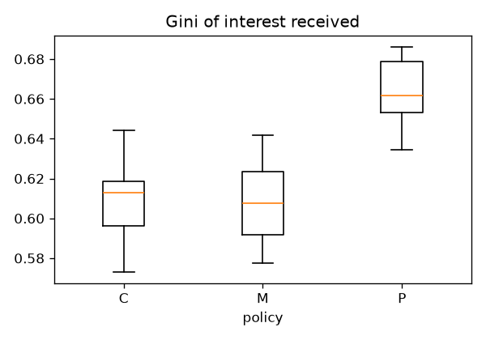
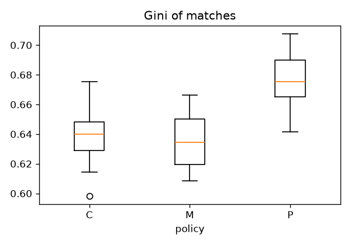
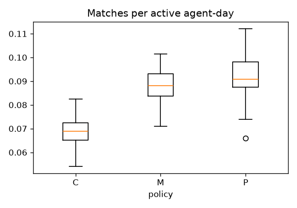
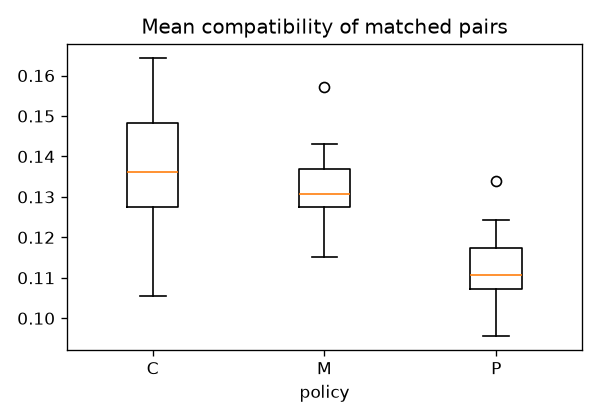
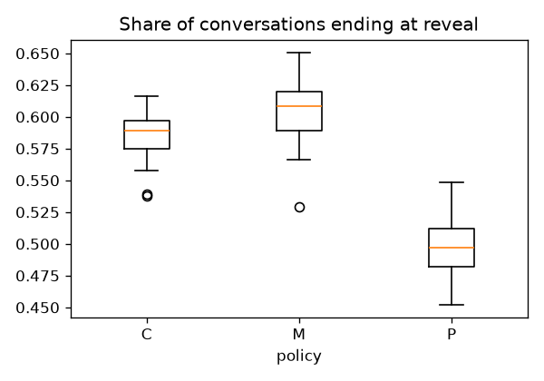
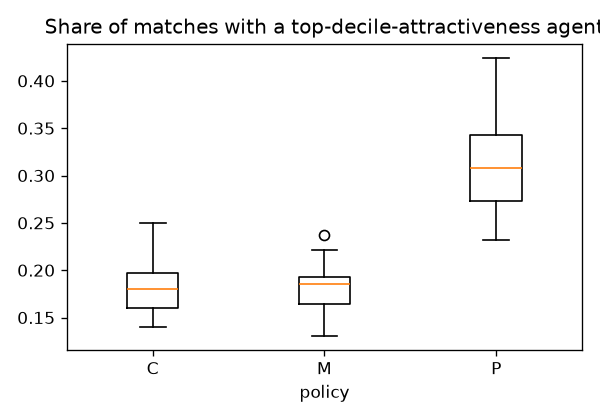
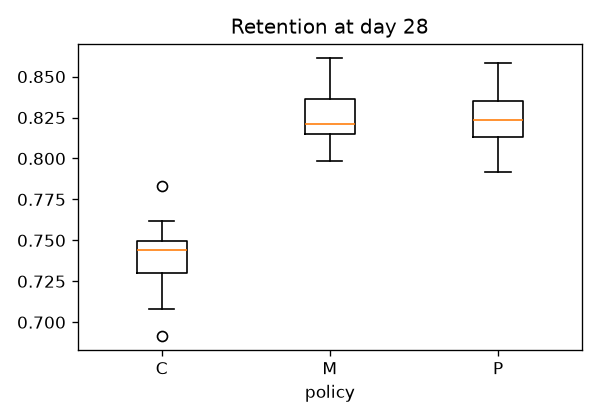
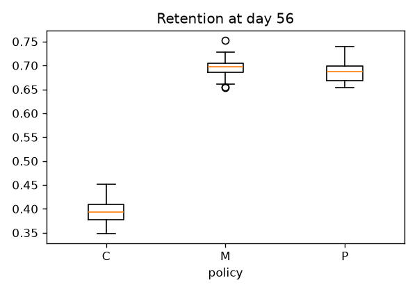

# Mutual simulation report (RQ2)

**All results below are conditional on this simulation's modelling assumptions** (SPEC.md §15) — a stochastic-block-model co-presence structure, a logistic-plus-utility signalling rule, and the parameter values in the table below, most of which are plausible assumptions rather than measurements. They describe how these three reveal policies behave *under this model*, not a measured fact about any real population. See `docs/DECISIONS_LOG.md` entry #17 for the modelling choices made where SPEC.md §15 left a gap (an explicit judgement call, not a hidden one).

Main experiment: 3 policies x 30 seeds, 56 days each. Runtime: 10.2 s on one CPU core.

## Parameters

| Parameter | Value |
|---|---|
| `N` | `600` |
| `n_hostels` | `6` |
| `n_departments` | `8` |
| `compatibility_dim` | `8` |
| `activity_alpha` | `2` |
| `activity_beta` | `2` |
| `date_openness_prob` | `0.6` |
| `sbm_same_hostel` | `0.05` |
| `sbm_same_department` | `0.02` |
| `sbm_otherwise` | `0.002` |
| `beta_a` | `1.0` |
| `beta_c` | `1.0` |
| `tau` | `0.5` |
| `K` | `20` |
| `display_cap` | `40` |
| `interest_ttl_days` | `7` |
| `n_reveal` | `8` |
| `gamma_a` | `1.0` |
| `gamma_c` | `1.0` |
| `gamma_0` | `0.5` |
| `delta` | `0.5` |
| `phi` | `0.02` |
| `h_0` | `0.01` |
| `h_f` | `0.05` |
| `h_m` | `0.02` |
| `recent_matches_window_days` | `7` |
| `T` | `56` |
| `policies` | `['P', 'M', 'C']` |
| `seeds_main` | `30` |
| `retention_checkpoints` | `[28, 56]` |

## Results by policy (mean, 95% bootstrap CI over seeds)

| Metric | C (95% CI) | M (95% CI) | P (95% CI) |
|---|---|---|---|
| Gini of interest received | 0.610 [0.604, 0.615] | 0.607 [0.601, 0.614] | 0.664 [0.658, 0.669] |
| Gini of matches | 0.638 [0.633, 0.644] | 0.635 [0.629, 0.641] | 0.676 [0.670, 0.681] |
| Matches per active agent-day | 0.069 [0.067, 0.071] | 0.088 [0.085, 0.091] | 0.092 [0.088, 0.095] |
| Mean compatibility of matched pairs | 0.137 [0.132, 0.142] | 0.132 [0.129, 0.135] | 0.112 [0.109, 0.115] |
| Share of conversations ending at reveal | 0.584 [0.577, 0.591] | 0.605 [0.595, 0.614] | 0.496 [0.489, 0.504] |
| Share of matches with a top-decile-attractiveness agent | 0.182 [0.173, 0.191] | 0.180 [0.171, 0.189] | 0.312 [0.296, 0.330] |
| Retention at day 28 | 0.740 [0.734, 0.746] | 0.825 [0.820, 0.831] | 0.824 [0.819, 0.829] |
| Retention at day 56 | 0.394 [0.385, 0.403] | 0.695 [0.688, 0.702] | 0.686 [0.679, 0.694] |

## Figures

## Sensitivity sweep

4050 runs (3 policies x 45 cells x 30 seeds). Runtime: 460.8 s.

Grid: `beta_a_over_beta_c`: [0, 0.5, 1, 2, 4], `phi`: [0, 0.02, 0.08], `K`: [5, 10, 20]

**Conclusions that reverse somewhere in the sweep:**
- **Gini of interest received**: main experiment favours P, but 9 sweep cell(s) favour a different policy instead (e.g. beta_a_over_beta_c=0.0, phi=0.0, K=5 favours M).
- **Gini of matches**: main experiment favours P, but 9 sweep cell(s) favour a different policy instead (e.g. beta_a_over_beta_c=0.0, phi=0.0, K=5 favours M).
- **Matches per active agent-day**: main experiment favours P, but 9 sweep cell(s) favour a different policy instead (e.g. beta_a_over_beta_c=0.0, phi=0.0, K=5 favours M).
- **Share of matches with a top-decile-attractiveness agent**: main experiment favours P, but 9 sweep cell(s) favour a different policy instead (e.g. beta_a_over_beta_c=0.0, phi=0.0, K=5 favours C).
- **Retention at day 28**: main experiment favours M, but 21 sweep cell(s) favour a different policy instead (e.g. beta_a_over_beta_c=0.0, phi=0.0, K=5 favours C).
- **Retention at day 56**: main experiment favours M, but 18 sweep cell(s) favour a different policy instead (e.g. beta_a_over_beta_c=0.0, phi=0.0, K=5 favours C).

